# PowerPlant Simulator

A physics-based simulator of a steam power plant: a gas-fired boiler drives a turbine and generator, and a condenser returns the steam as water to the boiler. You run the plant by hand (burner, valves, pumps, generator breaker) and watch temperature, pressure, flow and electrical output respond in real time.

Formerly called Steamboiler. React + TypeScript + Vite, no backend.

**Try it:** <https://narubyriverlione.github.io/steamboiler/> (the latest release on `main`).

## The plant



What each part does and where the energy comes from: [plant overview](docs/plant/overview.md).

## Purpose

An educational tool for the thermodynamics of steam generation and power production, without the risk or cost of a physical plant: a safe place to practise plant operation and start-up sequences, and to make the relationships between temperature, pressure, flow and energy tangible. For students, educators, professionals refreshing their knowledge and curious learners.

## Realism rule

The physics is realistic: a process is never sped up with a magic number, such as an inflated heat-transfer coefficient, a scaled-down heat capacity or a time multiplier. Playability comes from how the utilities are sized (gas flow, pump capacity) and from the playback speed (1x, 10x, 60x), which runs more ticks per second and leaves the physics alone ([ADR 0034](docs/adr/0034-playback-speed-is-ticks-per-second.md)): a cold start takes about 6 hours of plant time, as on a real unit. Every deliberate departure from a real plant is listed in the register in [docs/plant/design-basis.md](docs/plant/design-basis.md). See also [ADR 0001](docs/adr/0001-boiler-pressure-follows-saturation.md).

## Where we are

You can run the plant from a cold start to a generator on the line, and keep it running when its power supply fails:

- **Start-up:** fill the boiler cold and heat it at the real 100 K/h limit, vent the deaerator, start the lube oil and the turning gear, seal the glands, pull vacuum with the air extraction pump and the SJAE, open the main steam valve at working pressure, roll the turbine off the gear up to sync speed and close the generator breaker.
- **Steam and water:** burner and boiler with economizer, superheater with spray attemperator, turbine with an extraction heater, condenser with hotwell and an air system (air pump with seal water, SJAE), and a deaerator with a boiler feed pump. Every stream carries its real enthalpy and water is conserved to rounding.
- **Turbine auxiliaries:** lube oil with a permissive and a trip, the turning gear, gland seal steam.
- **Electrical:** the auxiliary bus fed by the grid supply, by the generator (house load operation) or by a diesel for an island start; the vital and safety buses below it, with a UPS that takes over by itself and an emergency diesel; net output after the plant's own load.
- **Protections:** boiler relief valve; trips on low and high-high boiler level, vacuum loss, overspeed, low lube oil, low main steam pressure, hotwell low-low, deaerator low-low and high-high, and a hot air pump seal water; alarms and a reset for each latched trip.
- **Board:** an analog control-room style UI with a plant overview, an electrical overview and a page per part (boiler, steam, deaerator, condenser, turbine, turbine aux, generation, auxiliary bus, emergency power, diesel); the board goes into an emergency state when the vital bus is lost.
- **Testing:** unit tests plus golden-path and edge scenarios run by the [headless runner](docs/dev/headless-runner.md), with a CRAP-score check on changed code.

Not there yet: the grid is not modelled, so the speed stays free with the breaker closed and there is no load demand; the turbine casing has no temperature, so it rolls on 540 °C steam into cold metal; the gland steam comes from the boiler, as there is no auxiliary steam header; and the whole-plant energy balance is not checked by a test.

The full state and the plan that follows from it: the [review of 27 November 2026](docs/research/2026-11-review.md) (ADRs against the code, realism, missing components, tickets to create).

## Where we are going

**Next: the boiler as tubes** (proposed, [ADR 0057](docs/adr/0057-boiler-as-a-tube-model.md)). The boiler is one lumped vessel today ([ADR 0019](docs/adr/0019-boiler-is-one-lumped-vessel.md)). The plan is a tube model, which brings swell and shrink, a drum level with real meaning and real thermal stress, and resets the boiler volume and metal mass. No new plant systems are added before its impact is seen, with one exception: the grid (Electrical M1 below) goes ahead. Small fixes from the review go on meanwhile.

Then three ladders, each in milestones:

- **Electrical:** a plant that serves a **town grid** whose demand follows a day-night cycle ([ADR 0046](docs/adr/0046-from-island-to-town-grid-in-milestones.md)). Built: the plant's own power (M2) and the vital bus and UPS side track. To come:
  1. **M1:** on the grid with auto-sync, a MW load controller, reverse power trip
  2. **M3:** the town grid: finite inertia, frequency from the balance of demand and supply, governor droop
  3. **M4:** manual sync with a synchroscope
  4. **M5:** operating for the town: load set from frequency and demand
  5. **M6:** a 24-hour demand curve
  6. **M7:** a satisfaction score and demand that grows
- **Turbine auxiliaries:** a real cold start ([ADR 0048](docs/adr/0048-from-roll-on-demand-to-a-real-cold-start-in-milestones.md)). Built: oil and gear (M1), gland steam. To come: the auxiliary steam header (M2), casing metal with prewarming and a steam-to-metal permissive (M3), a hot restart (M4).
- **Release:** a first public build on itch.io, with a goal, help cards and a startup guide ([ADR 0052](docs/adr/0052-first-public-release-on-itch-io.md)).

Proposed, not decided: sustainable operation over many sessions, with saving, an account and wear as cost ([ADR 0049](docs/adr/0049-sustainable-operation-in-milestones.md)). Other parts (reheat, air preheater, superheater protection) wait in triage. The order is in [ROADMAP.md](ROADMAP.md).

## Releases

Work lands on `dev`, one ticket at a time, each through its test gate. `main` holds the milestone releases and is deployed to GitHub Pages on every merge. A release is a pull request from `dev`, merged once its gate (edge scenarios and speed guard, on top of the `dev` gate) is green. What and how: [docs/dev/branching.md](docs/dev/branching.md).

## Quick start

Requires Node 24+ and pnpm.

```sh
pnpm install
pnpm dev                 # run the app (reachable on the LAN)
pnpm test                # vitest: unit, golden, edge
pnpm lint                # eslint + tsc
pnpm sim bypass-loop     # headless scenario run, writes a CSV and HTML report to sim/reports/
pnpm sim:view            # run a scenario and serve the report on the LAN
```

The headless runner is how physics changes are judged: see [docs/dev/headless-runner.md](docs/dev/headless-runner.md).

## Documentation

Start at [docs/README.md](docs/README.md). The work order is in [ROADMAP.md](ROADMAP.md), generated from the GitHub issues. Domain terms are in [GLOSSARY.md](GLOSSARY.md).
