# Boiler efficiency follows from a two-stage flue gas heat balance

The fixed `GasEfficiency` of 85% goes. Boiler efficiency now follows from a heat balance on the flue gas, which passes two heat exchangers in turn: the boiler surface, then the economizer. It had no source, and it could not be right: with no economizer, even flue gas leaving at the boiler water temperature gives 84.0% ([research](../research/2026-11-economizer-flue-gas.md)). Decided in #87.

## The model

- **Heat balance:** fuel heat = heat into the water + heat up the stack, with the fuel at its lower heating value. `GasEnergyDensity` (35 000 kJ/m³) is defined as a lower heating value, so full gas stays 420 MW. The existing heat loss still comes off the water afterwards; there is no separate radiation term, so no loss is counted twice.
- **Flue gas:** 14.7 kg per m³ of gas at 15% excess air, at every firing rate, starting from a combustion temperature of 1775 °C.
- **Boiler stage:** a heat exchanger between the flue gas and the boiler water, with its own sized surface. It is sized for flue gas 100 K above the water at full gas and 350 °C (estimate; the sourced span is 60 to 150 K, none above 254 °C saturation).
- **Economizer:** a heat exchanger between the flue gas and the Return. It is sized for a 160 °C stack at full gas with 171 kg/s of Return at 37 °C, about 290 kW/K (a design choice, not a real unit's figure). With no Return it recovers nothing.
- **Surfaces** scale with gas flow to the power 0.65. The water side is left out, as the gas side dominates.
- **Return limit:** the Return leaves the economizer at least 28 K below saturation (UNVERIFIED). Heat it cannot take stays in the flue gas, so the stack temperature rises and efficiency falls.

Expected at full gas and 350 °C: about 93.4% with the design Return, about 79% with no Return.

## Where it sits in the plant

The plant as built: [overview.md](../plant/overview.md). This is the plant to be: all its parts, with what this ADR, [ADR 0030](0030-return-pays-real-enthalpy.md) and [ADR 0031](0031-one-extraction-heater.md) add. The dashed part is the air preheater, parked in #90: not decided, and it may never be built.

Before #88 the Return ran from the hotwell straight to the economizer. Since it, the water gets its heat from three places, in order: extraction steam, flue gas, and last the boiler itself. Heat the flue gas gives the Return is heat that would otherwise leave up the stack. A hotter Return leaves the flue gas hotter after the economizer, so an air preheater would take that last heat and give it to the combustion air.

## Fit with ADR 0019

The economizer sits outside the vessel and has no temperature or mass of its own, so the boiler is still [one lumped vessel](0019-boiler-is-one-lumped-vessel.md). The boiler stage describes the flue gas, not the water, and splits nothing. This ADR does not supersede 0019.

## Considered options

- **Two fixed efficiencies, with and without Return:** rejected. It is not a heat balance, and a cold boiler lets flue gas cool much further than a boiler at 350 °C.
- **A fixed stack temperature:** rejected. It ignores the Return's flow and temperature, and hides what hotter Return does in #88.
- **A fixed approach above the boiler water:** first choice, dropped once the research came in. In the one source with part-load data the approach falls from 149 K at full load to 30 K at 25%, and with a fixed approach the Return outlet temperature moves the wrong way as load falls. A sized surface falls to about the same share in a hand check, for about the same effort. That check rests on one table from a superheated industrial unit.
- **Thermal mass in the economizer:** left out for now. It needs a new state and a figure with no measured source. Added only if the headless runs show the pressure hold misbehaving.
- **An air preheater:** left out. The need comes with the hotter Return of #88, and it has its own ticket, #90.

## Consequences

- Built in #87: economizer surface about 291 kW/K, boiler stage about 668 kW/K; measured 160 °C stack, 93.4% and 121.6 °C Return out at full gas, 79% with no Return, an 18 K gap at 25% gas. The relief capacity was about 551 kg/s, re-derived to about 457 kg/s in #74. `return-stop` (edge) confirms the pressure stays controlled when the Return stops at full gas, with no lag.
- #87 landed before #74, with no release to `main` between them. #74 ([ADR 0030](0030-return-pays-real-enthalpy.md)) removed the free Return, using the Return temperature after the economizer that #87 calculates.
- Relief valve sizing no longer has one efficiency to use. Since #74 the worst case is full gas at the opening pressure with no Return ([ADR 0005](0005-relief-valve-vents-to-atmosphere.md), [ADR 0030](0030-return-pays-real-enthalpy.md)): the economizer recovers nothing, and the cold Return no longer eats heat that could make steam.
- When the Return stops, heat input steps down in one tick, about 60 MW at full gas.
- Efficiency comes out too high at low firing, as excess air stays at 15% and the stack has no floor.
- The economizer's cold end sits below the flue gas water dew point of about 58 °C with no condensation or corrosion modelled.
- Almost every figure comes from industrial boilers. No gas-fired utility data was found.
