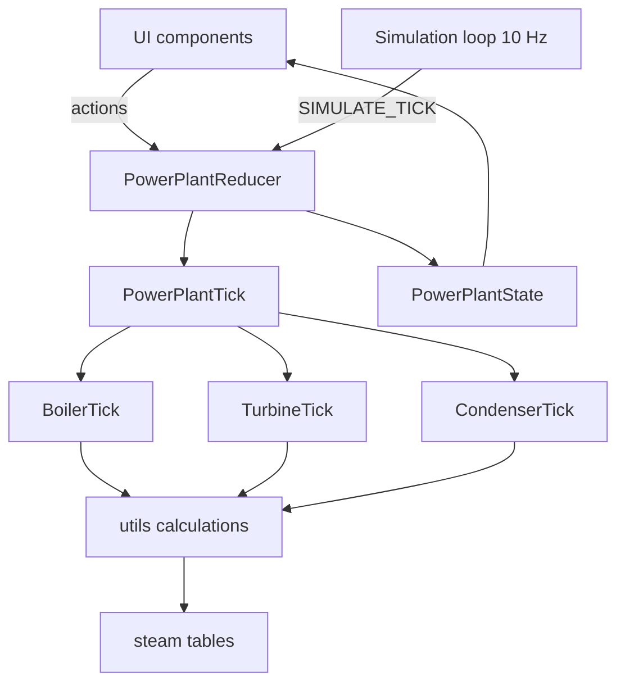

# Architecture

## Stack

React 19, TypeScript, Vite, react-router-dom, Vitest. CSS files per component. pnpm. No backend, no persistence: all state lives in memory for the session.

## State management

One reducer and one provider for the whole plant.

- `PowerPlantReducer` (`src/context/`) is the only state-transition point. It handles user actions and the tick.
- `PowerPlantProvider` owns the simulation loop and exposes state through `PowerPlantContext`.
- Simulation core is pure functions, decoupled from React: `PowerPlantTick` calls `BoilerTick`, `TurbineTick`, `CondenserTick` (in `src/context/<Subsystem>/`).
- Physics lives in `src/utils/` (`boilerCalculations`, `condenserCalculation`, `turbineCalculations`, `steamTable`, `steamData`).
- State is immutable. Every update creates a new state object.
- Display-only values are calculated in components, not stored in state. `useEMA` smooths readouts.



## Simulation loop

`PowerPlantProvider` dispatches `SIMULATE_TICK` with the real elapsed `deltaTime` every 100 ms (10 updates/s) from a `setInterval` in `useEffect`, cleaned up on unmount. Each tick runs boiler, turbine and condenser, so steam, condensate and energy move between subsystems.

Each subsystem uses an energy balance:

```
Boiler:    ΔE = gas input − (cooling + steam generation + drain)
Condenser: ΔE = steam input − (cooling + condensation)
```

## Source layout

```
src/
├── components/
│   ├── Boiler/ Condenser/ Turbine/   # Visual, Readouts, ControlPanel, controls per subsystem
│   ├── Indicator.tsx Readout.tsx ValveSlider.tsx
│   └── simulator.css                 # shared simulator styling
├── context/
│   ├── PowerPlant{Actions,Context,Provider,Reducer,State,Tick}
│   ├── const.ts                      # all tunable constants (Cst* objects)
│   └── Boiler/ Condenser/ Turbine/   # <Subsystem>Tick.ts
├── navigation/                       # routing, tab navigation, layout
└── utils/                            # calculations, steam tables, useEMA, average
```

## Conventions

- Constants use a `Cst` prefix (`CstPhysics`, `CstSimulation`, `CstTurbine`) and live in `src/context/const.ts`. Do not hardcode tunables in calculations.
- Components PascalCase, functions camelCase, types PascalCase. Use `type`, not `interface`. No `any`.
- Default exports where possible. Function components with hooks. Explicit parameter and return types.
- Context, provider and logic in separate files. All calculations in `src/utils/`.
- One CSS file per component. Numbers formatted with `toFixed()` for display, 1 decimal.
- Do not change the eslint configuration.
- Units: °C, bar (vacuum in mbar), kJ for energy, litres for volume.

## Steam tables

`steamTable.ts` holds 80–300 °C data (pressure, specific volume, enthalpy, specific heat, latent heat) with linear interpolation. Outside that range:

- Boiling point: Antoine equation below the table, power law above
- Latent heat: linear extrapolation at low temperature
- Water properties below 80 °C: linear approximation

## Numerical stability

- Phase changes alter system properties quickly, so pressure uses damping factors (configurable in `CstSimulation`).
- Vacuum build-up and decay rates need careful tuning.
- Edge cases: empty boiler, temperatures or pressures beyond the table, very small steam mass (minimum threshold before it affects pressure).

## Testing and commands

Run in `steamboiler-web/`: `pnpm dev`, `pnpm test` (Vitest, 90% coverage target), `pnpm lint` (eslint + tsc). The planned scenario runner is in [headless runner.md](headless%20runner.md).
