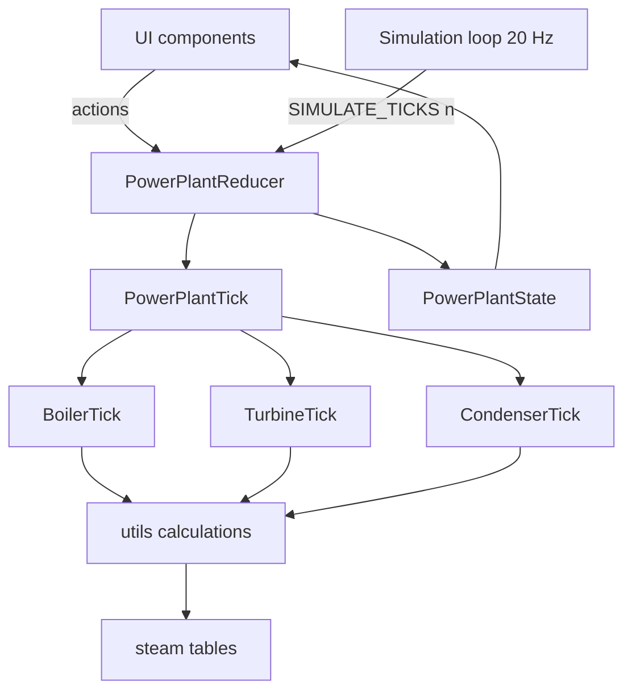

# Architecture

## Stack

React 19, TypeScript, Vite, react-router-dom, Vitest. CSS files per component. pnpm. No backend, no persistence: all state lives in memory for the session.

## State management

One reducer and one provider for the whole plant.

- `PowerPlantReducer` (`src/context/`) is the only state-transition point. It handles user actions, the tick and `LOAD_STATE`, which replaces the whole state with a UI preset (#24). The preset list is `src/context/startPresets.ts`; the shape check that rejects a stale snapshot is `src/utils/stateShape.ts`, shared with the headless runner.
- `PowerPlantProvider` owns the simulation loop and exposes state through `PowerPlantContext`.
- Simulation core is pure functions, decoupled from React: `PowerPlantTick` calls `BoilerTick`, `TurbineTick`, `CondenserTick` (in `src/context/<Subsystem>/`). Order per tick: the relief valve vents (`BoilerVent`), the main steam valve closes on low pressure (`MainSteamValveLowPressureClosure`), remove bypass steam, `TurbineTick`, remove turbine steam, `CondenserTick` with those same-tick flows, then `BoilerTick` with the return.
- Physics lives in `src/utils/` (`boilerCalculations`, `condenserCalculation`, `turbineCalculations`, `steamTable`, `steamData`). Display helpers (`formatSigned`, `flowUnits`: l/s design values shown as kg/s, #123) sit beside them.
- State is immutable. Every update creates a new state object.
- Display-only values are calculated in components, not stored in state. `useEMA` smooths readouts.



## Simulation loop

`PowerPlantProvider` runs a `setInterval` every `UpdateInterval` (50 ms). Each update asks `ticksDue` (`Playback.ts`) how many fixed ticks the elapsed wall time earns at the chosen playback speed, and dispatches one `SIMULATE_TICKS` with that count: one render per update. `DeltaTime` stays 0.1 s; speed is ticks per wall-clock second, 1x = 10 per second ([ADR 0034](../adr/0034-playback-speed-is-ticks-per-second.md)). The count is capped at `MaxTicksPerUpdate`; above it the plant runs slower, no tick is skipped. A hidden tab and Pause run nothing and bank no time, so there is no catch-up.

`simulationReducer` (`SimulationReducer.ts`) wraps the plant reducer with state kept outside `PowerPlantState`: the tick count (the simulated clock, `ticks × DeltaTime`) and the playback speed. In the same step as a batch it applies the alarm rule: an alarm from the annunciator's list (`navigation/alarms.ts`, the single source) that comes on stops the batch on that tick and drops the speed to 1x. `LOAD_STATE` (a preset) resets the clock and the speed.

The header (`navigation/TimeControl.tsx`) shows the clock (an LCD `Display`, flashing while paused) and the speed selector in its `clock` and `speed` slots. The selector disables speeds above 1x while an annunciator tile flashes (unacknowledged).

Each subsystem uses an energy balance:

```
Boiler:    ΔE = gas input − (heat loss + steam generation + drain)   (E: water and metal)
Condenser: ΔE = steam input − (cooling + condensation)
```

## Source layout

```
src/
├── components/
│   ├── Boiler/ Condenser/ Turbine/   # one page per subsystem; Boiler, Condenser and Turbine are single board pages (ui-board.md)
│   └── board/                        # board primitives and board.css (ui-board.md); ValveControl
├── context/
│   ├── PowerPlant{Actions,Batch,Context,Provider,Reducer,State,Tick}
│   ├── SimulationReducer, Playback, Alarms   # clock, playback speed, alarm rule
│   ├── const.ts                      # all tunable constants (Cst* objects)
│   └── Boiler/ Condenser/ Turbine/   # <Subsystem>Tick.ts
├── navigation/                       # routing, header, annunciator, plant overview
└── utils/                            # calculations, steam tables, useEMA
sim/                                  # headless scenario runner, see headless-runner.md
├── scenarios/                        # one file per scenario, registered in index.ts
├── snapshots/                        # committed start states (JSON)
└── reports/                          # generated CSV + HTML, git-ignored
scripts/roadmap.ts                    # generates ROADMAP.md from the GitHub issues
```

## Conventions

- Constants use a `Cst` prefix (`CstPhysics`, `CstSimulation`, `CstTurbine`) and live in `src/context/const.ts`. Do not hardcode tunables in calculations.
- Components PascalCase, functions camelCase, types PascalCase. Use `type`, not `interface`. No `any`.
- Default exports where possible. Function components with hooks. Explicit parameter and return types.
- Context, provider and logic in separate files; components read state through the context hook. All calculations in `src/utils/`.
- One CSS file per component. Numbers formatted with `toFixed()` for display, 1 decimal.
- Do not change the eslint configuration.
- Units: °C, bar (vacuum in mbar), kJ for energy, litres for volume.

## Steam tables

`steamData.ts` holds IAPWS-IF97 saturation data from 80 °C to the critical point (373.946 °C, 220.64 bar): pressure, specific volume, enthalpy, specific heat, latent heat. `steamTable.ts` interpolates it linearly. `steamEntropyData.ts` is a second, pressure-keyed saturation table (hf, hg, sf, sg, 0.01–220 bar) for `getIsentropicEnthalpyDrop`, interpolated in ln(pressure) (#14). Outside that range: `steamSuperheatedData.ts` (#113, ADR 0044) is a third table, superheated steam by pressure and superheat above saturation (enthalpy and entropy, 1 to 200 bar), read by `getSteamEnthalpy`, `getSteamEntropy` and `getSteamTemperature` in `steamTable.ts`. The superheater stage is in `utils/flueGas.ts`; the spray attemperator PID and the steam temperature equilibrium are in `context/Boiler/Attemperator.ts`, called from `BoilerTick`.

- Above the critical point (temperature or pressure): clamp to the critical-point row, never throw
- Boiling point below the table: Antoine equation
- Latent heat below 80 °C: linear extrapolation
- Water properties below 80 °C: linear approximation

## Numerical stability

- Boiler pressure is the saturation pressure of the water temperature ([ADR 0001](../adr/0001-boiler-pressure-follows-saturation.md)); the flash that restores the steam inventory each tick is solved implicitly, because an explicit step oscillates near the critical point.
- Vacuum build-up is the air inventory of the shell (ADR 0035); see condenser.md.
- Edge cases: empty boiler, temperatures or pressures beyond the table, very small steam mass (minimum threshold before it affects pressure).

## Testing and commands

Run at the repo root: `pnpm dev`, `pnpm test` (Vitest, 90% coverage target), `pnpm lint` (eslint + tsc). Physics changes are judged with the headless runner and guarded by its scenario and invariant tests: see [headless-runner.md](headless-runner.md). The full command list is in `CLAUDE.md`.
