# Plant overview

How the parts of the plant connect, what each one does, and where the energy comes from. This page shows the plant as built. The plant to be, with the economizer, the extraction heater and the parked air preheater: [ADR 0029](../adr/0029-boiler-efficiency-from-flue-gas-heat-balance.md#where-it-sits-in-the-plant).

## Schema

| Colour | Medium |
|---|---|
| Orange | Gas, and heat leaving as a loss |
| Purple | Steam |
| Blue | Water |
| Teal | Cooling water |
| Yellow | Shaft and electricity |
| Grey, dashed | Vacuum system; no water or heat moves on these lines |

## What each part does

| Part | What it does | More |
|---|---|---|
| Burner | Burns gas. The flue gas gives its heat to the boiler water, then to the Return in the economizer; what is left goes up the stack, so efficiency follows from the heat balance (about 93% at full gas) | [boiler.md](boiler.md) |
| Boiler | One lumped vessel of water and steel. Heat turns water into saturated steam, and pressure follows the temperature | [boiler.md](boiler.md) |
| Relief valve | Vents steam to the atmosphere at high pressure, upstream of the main steam valve | [boiler.md](boiler.md#relief-valve) |
| Main steam valve | Opens or shuts the boiler to both the turbine valve and the bypass | [turbine.md](turbine.md#low-pressure-closure) |
| Turbine valve | Sets the steam flow to the turbine | [turbine.md](turbine.md) |
| Bypass valve | Sends steam straight to the condenser, past the turbine | [condenser.md](condenser.md#intakes) |
| Turbine | Takes the enthalpy drop from boiler pressure to condenser pressure as shaft power, in one stage. The steam is saturated, as there is no superheater | [turbine.md](turbine.md#electric-output-14-since-71-the-load-carried) |
| Deaerator | Feedwater tank (150 m³) between the hotwell and the boiler, held at 3 bar (134 °C) by turbine tap steam first and boiler steam through a let-down valve for the rest; the boiler feed pump takes the water out toward the boiler and trips on low-low (#112) | [deaerator.md](deaerator.md) |
| Extraction heater | Takes steam from the turbine at a tap (about 5 bar at the rated flow) and heats the deaerator outflow to about 150 °C before the economizer; its drain cascades back into the deaerator. Passive: no controls | [turbine.md](turbine.md#extraction-heater-88) |
| Generator | Turns shaft power into the load it carries, at 98% | [turbine.md](turbine.md#generator-load-71) |
| Condenser | Condenses the vapour under vacuum. Cooling water carries the heat away | [condenser.md](condenser.md#energy-balance) |
| Recirculation pump | Brings cooling water at 10 °C to the condenser | [condenser.md](condenser.md#energy-balance) |
| Air extraction pump | Pulls the first vacuum | [condenser.md](condenser.md#condenser-pressure-and-the-vacuum-system) |
| SJAE | Builds the deep vacuum, driven by boiler pressure. It takes no steam or heat from the boiler in the model | [condenser.md](condenser.md#condenser-pressure-and-the-vacuum-system) |
| Hotwell | Collects the condensate and the exhaust moisture. Makeup comes in here and reject goes out | [condenser.md](condenser.md#hotwell-makeup-and-reject) |
| Condensation pump | Moves hotwell water into the deaerator as the Return; holds the deaerator level | [feedwater-loop.md](feedwater-loop.md#return-and-capacity) |
| Boiler feed pump | Moves deaerator water into the boiler, the boiler's only water supply; holds the drum level | [deaerator.md](deaerator.md#boiler-feed-pump-112) |

## Where the energy comes from

Measured at the end of `turbine-load` (#74, #82, #88): 125.0 MW, 165 bar, 173 kg/s of steam of which 44 kg/s is extracted, the bypass shut, gas 10 770 L/s. Heat figures are calculated from that run; the balance closes within 0.5% of the fuel heat (golden test).

| In | MW | | Out | MW |
|---|---|---|---|---|
| Gas (fuel heat) | 377 | | Electricity | 125.0 |
| | | | Stack | 37 |
| | | | Boiler heat loss | 0.5 |
| | | | Generator and shaft losses | 7.5 |
| | | | Cooling water (rise 6.7 K) | 206.5 |
| | | | Not accounted (storage drift) | 0.2 |
| **Total** | **377** | | **Total** | **377** |

The Return pays for its heat: it enters at the hotwell temperature (about 21 °C), is warmed to 134 °C in the deaerator and to about 144 °C by the heater, to about 198 °C by the flue gas in the economizer, and the boiler heats it the rest of the way to the steam. The plant efficiency is 32.4% at 125 MW with the deaerator (#119; 33.2% with the heater alone in #88), electricity over fuel heat, against 31.4% before the heater (#82). The energy table above is the #88 balance and was not re-measured. The heater gains the cycle about 2 points, but the Return reaches the economizer hotter, so the stack rises from 148 to 227 °C and boiler efficiency falls from 94% to 90%; only part of the cycle gain survives ([ADR 0031](../adr/0031-one-extraction-heater.md)). The earlier free-feedwater departure is gone ([ADR 0030](../adr/0030-return-pays-real-enthalpy.md)).

Not in the table: makeup, reject and drain carry a little heat when they run, and no pump uses power.
