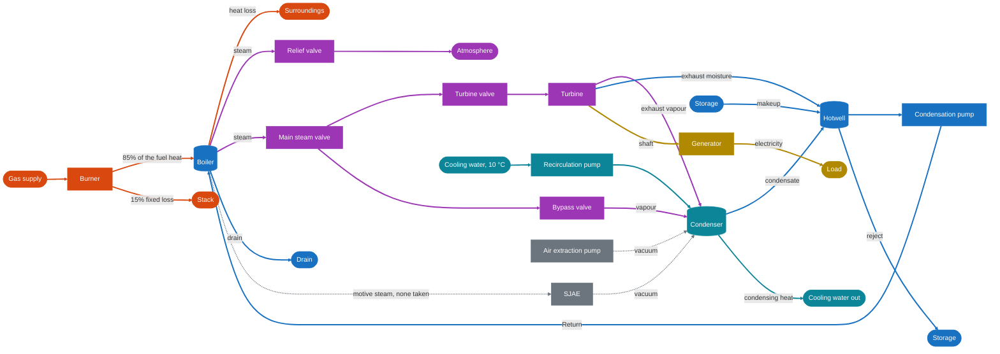

# Plant overview

How the parts of the plant connect, what each one does, and where the energy comes from. This page shows the plant as built. The plant after the economizer and the extraction heaters: [ADR 0029](../adr/0029-boiler-efficiency-from-flue-gas-heat-balance.md#where-it-sits-in-the-plant).

## Schema

| Colour | Medium |
|---|---|
| Orange | Gas, and heat leaving as a loss |
| Purple | Steam |
| Blue | Water |
| Teal | Cooling water |
| Yellow | Shaft and electricity |
| Grey, dashed | Vacuum system; no water or heat moves on these lines |

## What each part does

| Part | What it does | More |
|---|---|---|
| Burner | Burns gas. 85% of the fuel heat reaches the boiler water; the other 15% is a fixed loss, with no flue gas modelled | [boiler.md](boiler.md) |
| Boiler | One lumped vessel of water and steel. Heat turns water into saturated steam, and pressure follows the temperature | [boiler.md](boiler.md) |
| Relief valve | Vents steam to the atmosphere at high pressure, upstream of the main steam valve | [boiler.md](boiler.md#relief-valve) |
| Main steam valve | Opens or shuts the boiler to both the turbine valve and the bypass | [turbine.md](turbine.md#low-pressure-closure) |
| Turbine valve | Sets the steam flow to the turbine | [turbine.md](turbine.md) |
| Bypass valve | Sends steam straight to the condenser, past the turbine | [condenser.md](condenser.md#intakes) |
| Turbine | Takes the enthalpy drop from boiler pressure to condenser pressure as shaft power, in one stage. The steam is saturated, as there is no superheater | [turbine.md](turbine.md#electric-output-14-since-71-the-load-carried) |
| Generator | Turns shaft power into the load it carries, at 98% | [turbine.md](turbine.md#generator-load-71) |
| Condenser | Condenses the vapour under vacuum. Cooling water carries the heat away | [condenser.md](condenser.md#energy-balance) |
| Recirculation pump | Brings cooling water at 10 °C to the condenser | [condenser.md](condenser.md#energy-balance) |
| Air extraction pump | Pulls the first vacuum | [condenser.md](condenser.md#vacuum-system) |
| SJAE | Builds the deep vacuum, driven by boiler pressure. It takes no steam or heat from the boiler in the model | [condenser.md](condenser.md#vacuum-system) |
| Hotwell | Collects the condensate and the exhaust moisture. Makeup comes in here and reject goes out | [condenser.md](condenser.md#hotwell-makeup-and-reject) |
| Condensation pump | Moves hotwell water into the boiler as the Return, the boiler's only water supply | [feedwater-loop.md](feedwater-loop.md#return-and-capacity) |

## Where the energy comes from

Measured at the end of `turbine-load`: 130.6 MW, 165 bar, 172 kg/s of steam, of which 10 kg/s through the bypass. Heat figures are calculated from that run with the steam table.

| In | MW | | Out | MW |
|---|---|---|---|---|
| Gas | 181 | | Electricity | 131 |
| **Free heat in the Return** | **267** | | Generator and turbine losses | 7 |
| | | | Stack | 27 |
| | | | Boiler heat loss | 0.5 |
| | | | Cooling water | 283 |
| **Total** | **448** | | **Total** | **448** |

Gas alone would give the plant an efficiency of 72%, which no steam plant reaches. The Return is the reason: it enters the boiler at about 29 °C but costs no heat, as if it were already at the boiler's 350 °C. That is 1550 kJ per kg, more heat than the gas gives. Counting it, the efficiency is 29%. This is the free-feedwater departure in [design-basis.md](design-basis.md#deliberate-departures-from-a-real-plant), and [ADR 0030](../adr/0030-return-pays-real-enthalpy.md) removes it.

Not in the table: makeup, reject and drain carry a little heat when they run, and no pump uses power.
