# What a real plant has that this one does not

The owner's high-level view of how far the plant is from a real one. The order of work stays in [ROADMAP.md](../../ROADMAP.md) and the tickets; a row with no ticket is a candidate, not a plan. Deliberate departures with their figures are in [design-basis.md](design-basis.md). The plant to be, with what is already decided: [ADR 0029](../adr/0029-boiler-efficiency-from-flue-gas-heat-balance.md#where-it-sits-in-the-plant).

The rows come from general plant knowledge, not from a research note, so their effects are estimates (UNVERIFIED) unless an ADR is linked.

| Area | Missing | Effect on the sim | Status |
|---|---|---|---|
| **Steam** | Superheater, with spray attemperators to control its temperature | Very large: output, exhaust wetness, and a new control task | Built in #113 ([ADR 0044](../adr/0044-superheater-with-spray-attemperator.md)), operated on the Steam page (#149): one lumped superheater and one spray attemperator at 540 °C. Missing: stages, burner tilt and gas recirculation, an outlet safety valve, start-up vent and drains, a bypass spray, a trip on high steam temperature, tube overheating at low flow |
| | Reheat, where steam goes back to the boiler between turbine stages | Large, now that there is a superheater: the exhaust is still about 17% wet | #150, needs-triage |
| **Feedwater** | Deaerator | Moderate | Built in #119 and #120 ([ADR 0036](../adr/0036-deaerator-is-a-steam-heated-tank.md), [ADR 0038](../adr/0038-deaerator-air-and-vents.md)), with the boiler feed pump of #112 |
| | Boiler feed pump head and feed control valve; the feed pump of #112 is a flow actuator with no head | Moderate, and a good operator task | Departure in [ADR 0031](../adr/0031-one-extraction-heater.md) |
| | Five to eight heaters instead of one | Efficiency only | Deliberate in [ADR 0031](../adr/0031-one-extraction-heater.md) |
| **Flue gas** | Air preheater | Efficiency | #90, parked |
| **Firing** | Air and flue gas fans, furnace purge, flame detection | Mainly a start-up sequence | No ticket |
| **Water quality** | Polishing, chemical dosing, continuous blowdown, the demineralising plant behind makeup | Almost no effect on the physics | No ticket |
| **Boiler** | Real drum and tubes: circulation, swell and shrink, a drum level in mm, a separate metal temperature | Almost none on output and efficiency. Very large on behaviour: harder level control, level trips with real meaning, real thermal stress | Deliberately left out ([ADR 0019](../adr/0019-boiler-is-one-lumped-vessel.md)); changing it needs a new ADR and a ticket |
| **Turbine** | Separate HP, IP and LP casings; moisture separators | Partly follows from the superheater (the exhaust is 17% wet since #113) | Separators are a departure in [ADR 0031](../adr/0031-one-extraction-heater.md) |
| | Lube oil, turning gear, casing metal temperature and prewarming, auxiliary steam header | Start-up and shutdown steps | Planned in milestones ([ADR 0048](../adr/0048-from-roll-on-demand-to-a-real-cold-start-in-milestones.md), #145–#148; lube oil built in #145, [ADR 0050](../adr/0050-lube-oil-pressure-permissive-and-trip.md); turning gear in #146, [ADR 0051](../adr/0051-turning-gear-holds-the-stopped-rotor-and-blocks-the-valve.md); gland seal steam built in #147, [ADR 0047](../adr/0047-gland-seal-steam-sets-the-air-in-leakage.md), as a switch with no seal pressure and no loss of the seal on a trip) |
| | Second (mechanical) overspeed trip stage and a pre-trip alarm | Protection | The one trip at `MaxRPM` is in ([ADR 0040](../adr/0040-turbine-trip-on-overspeed.md), #72) |
| **Electrical** | Synchronising to a real grid, excitation, transformer | Operator task | Planned in milestones: auto-sync on a stiff grid (M1) and manual sync (M4) of [ADR 0046](../adr/0046-from-island-to-town-grid-in-milestones.md); no tickets yet |
| | Plant's own power use: pumps and fans take about 5 to 10% of output | Small and cheap to add; turns gross output into net | Six pumps and auxiliaries metered in #140 (auxiliary load, net output); burner fan, vents and lighting still out; the auxiliary bus is fed by the grid supply, the generator or the onsite diesel breaker in #141 and #169 (the diesel has no shaft, governor or fuel: #185, #186), while the vital bus and the safety bus with a UPS are in #143 and #196 (an automatic changeover to the UPS and a manual hand-back through the Aux→Vital and Vital→Safety breakers; one percentage for the battery, 30 minutes instead of hours, no DC distribution or inverters, no other UPS loads), and the emergency diesel on the vital bus in #198 (no rating, no overload, a fixed warm-up timer, no temperature, fuel or load-block model), and transformers and excitation are still out. Closing the grid supply breaker has no sync-check (a real one checks voltage, slip and angle onto a live bus); it needs the grid model of ADR 0046 M1 (#174) |
| **Cooling** | Cooling tower or river; the cooling water is always 10 °C | Seasonal effect on vacuum | No ticket |

**A middle route for the boiler:** swell and shrink may not need every tube modelled. A low-order drum model with about four states, as published by Åström and Bell (UNVERIFIED: from memory, needs a research note), could give the level behaviour without the full set of risers and downcomers.

## The plant with a superheater and a deaerator

The plant to be with the two biggest additions drawn in. A sketch, not a design: nothing dashed here is decided.

- **Superheater (built in #113, on the overview since #153):** drawn before the boiler surface, because flue gas after it is only about 100 K above the water ([ADR 0029](../adr/0029-boiler-efficiency-from-flue-gas-heat-balance.md)), too cool to superheat. In a real boiler the furnace walls come first, which the one boiler surface here cannot show. The overview draws the reheater (#150, parked and dashed) after it, and no longer draws the relief valve and the Atmosphere of the sketch.
- **Deaerator:** an open heater, so it needs a vessel with a level, a second pump and a change to [ADR 0002](../adr/0002-makeup-into-hotwell.md) ([ADR 0031](../adr/0031-one-extraction-heater.md)). That pump is the boiler feed pump. It takes the same extraction steam as the heater.
- **Heater drain:** it cascades into the deaerator, the usual arrangement, as built in #119 ([ADR 0036](../adr/0036-deaerator-is-a-steam-heated-tank.md)).
