# What a real plant has that this one does not

The owner's high-level view of how far the plant is from a real one. The order of work stays in [ROADMAP.md](../../ROADMAP.md) and the tickets; a row with no ticket is a candidate, not a plan. Deliberate departures with their figures are in [design-basis.md](design-basis.md). The plant to be, with what is already decided: [ADR 0029](../adr/0029-boiler-efficiency-from-flue-gas-heat-balance.md#where-it-sits-in-the-plant).

The rows come from general plant knowledge, not from a research note, so their effects are estimates (UNVERIFIED) unless an ADR is linked.

| Area | Missing | Effect on the sim | Status |
|---|---|---|---|
| **Steam** | Superheater, with spray attemperators to control its temperature | Very large: output, exhaust wetness, and a new control task | Built in #113 ([ADR 0044](../adr/0044-superheater-with-spray-attemperator.md)), operated on the Steam page (#149): one lumped superheater and one spray attemperator at 540 °C. Missing: stages, burner tilt and gas recirculation, an outlet safety valve, start-up vent and drains, a bypass spray, a trip on high steam temperature, tube overheating at low flow |
| | Reheat, where steam goes back to the boiler between turbine stages | Large, now that there is a superheater: the exhaust is still about 17% wet | No ticket |
| **Feedwater** | Deaerator | Moderate | #40, parked |
| | Boiler feed pump head and feed control valve; the feed pump of #112 is a flow actuator with no head | Moderate, and a good operator task | Departure in [ADR 0031](../adr/0031-one-extraction-heater.md) |
| | Five to eight heaters instead of one | Efficiency only | Deliberate in [ADR 0031](../adr/0031-one-extraction-heater.md) |
| **Flue gas** | Air preheater | Efficiency | #90, parked |
| **Firing** | Air and flue gas fans, furnace purge, flame detection | Mainly a start-up sequence | No ticket |
| **Water quality** | Polishing, chemical dosing, continuous blowdown, the demineralising plant behind makeup | Almost no effect on the physics | No ticket |
| **Boiler** | Real drum and tubes: circulation, swell and shrink, a drum level in mm, a separate metal temperature | Almost none on output and efficiency. Very large on behaviour: harder level control, level trips with real meaning, real thermal stress | Deliberately left out ([ADR 0019](../adr/0019-boiler-is-one-lumped-vessel.md)); changing it needs a new ADR and a ticket |
| **Turbine** | Separate HP, IP and LP casings; moisture separators | Partly follows from the superheater (the exhaust is 17% wet since #113) | Separators are a departure in [ADR 0031](../adr/0031-one-extraction-heater.md) |
| | Gland seal steam, lube oil, turning gear | Start-up and shutdown steps | No ticket |
| | Second (mechanical) overspeed trip stage and a pre-trip alarm | Protection | The one trip at `MaxRPM` is in ([ADR 0040](../adr/0040-turbine-trip-on-overspeed.md), #72) |
| **Electrical** | Synchronising to a real grid, excitation, transformer | Operator task | Sync is planned as phase 5 in [turbine.md](turbine.md) |
| | Plant's own power use: pumps and fans take about 5 to 10% of output | Small and cheap to add; turns gross output into net | No ticket |
| **Cooling** | Cooling tower or river; the cooling water is always 10 °C | Seasonal effect on vacuum | No ticket |

**A middle route for the boiler:** swell and shrink may not need every tube modelled. A low-order drum model with about four states, as published by Åström and Bell (UNVERIFIED: from memory, needs a research note), could give the level behaviour without the full set of risers and downcomers.

## The plant with a superheater and a deaerator

The plant to be with the two biggest additions drawn in. A sketch, not a design: nothing dashed here is decided.

- **Superheater (built in #113):** drawn before the boiler surface, because flue gas after it is only about 100 K above the water ([ADR 0029](../adr/0029-boiler-efficiency-from-flue-gas-heat-balance.md)), too cool to superheat. In a real boiler the furnace walls come first, which the one boiler surface here cannot show.
- **Deaerator:** an open heater, so it needs a vessel with a level, a second pump and a change to [ADR 0002](../adr/0002-makeup-into-hotwell.md) ([ADR 0031](../adr/0031-one-extraction-heater.md)). That pump is the boiler feed pump. It takes the same extraction steam as the heater.
- **Heater drain:** it runs to the deaerator here, the usual arrangement. With no deaerator it is pumped forward into the Return, as ADR 0031 decides.
